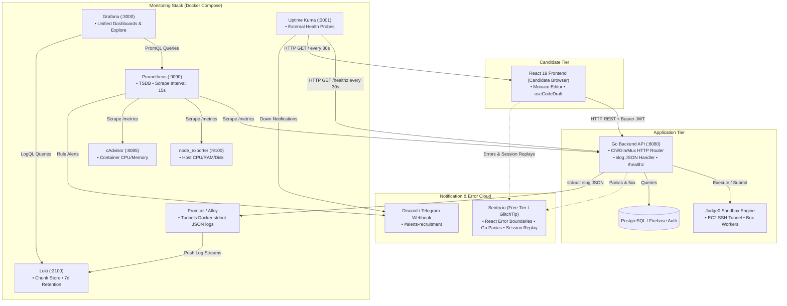

# End-to-End Monitoring & Logging Blueprint for PB-Recruitment

This document provides a comprehensive, production-grade guide to implementing full observability across the **`pb-recruitment-website`** (React 19 + Vite frontend), **`pb-recruitment-server`** (Go REST API), and the **Judge0** execution cluster.

---

## 1. High-Level Architecture & Connectivity

The observability architecture separates **metrics** (time-series counters/gauges), **logs** (structured event records), **exceptions** (stack traces & crash reports), and **synthetic uptime** into dedicated, resource-efficient pipelines that converge in Grafana and Sentry.



---

## 2. Technical Decisions & Feasibility Matrix

Every tool in this stack was chosen to satisfy three constraints: **Zero licensing cost ($0)**, **minimal CPU/RAM footprint**, and **maximum visibility during a live recruitment contest**.

| Component | Selected Technology | Alternative Rejected | Why This Decision Was Made & Why It Is Feasible |
| :--- | :--- | :--- | :--- |
| **Metrics Storage** | **Prometheus** | InfluxDB, VictoriaMetrics, Datadog | **Zero cost & standard.** The Go client library (`prometheus/client_golang`) is the gold standard for Go. Prometheus uses pull-based scraping which prevents the Go backend from crashing if the metric server is slow. TSDB memory footprint is small (< 300MB RAM for 7 days retention). |
| **Log Aggregation** | **Loki + Promtail** | ELK (Elasticsearch + Logstash + Kibana), OpenSearch | **Extreme efficiency.** Elasticsearch requires 4–8GB of RAM just to stay idle because it indexes every word. Loki only indexes metadata labels (`container`, `level`), storing compressed chunks on disk. Promtail reads directly from Docker's JSON log socket with zero code changes needed. Total footprint < 250MB RAM. |
| **Crash & UX Tracking** | **Sentry (Cloud Free Tier)** | Roll-your-own DB logging, PostHog | **Symbolicated traces & Session Replays.** When a candidate's Monaco Editor freezes or React throws, Sentry captures the browser version, OS, Redux/state snapshot, and a video-like replay of candidate clicks. Sentry's Free Developer plan gives 5,000 errors and 10,000 transactions/mo for $0. *(Can also be swapped with self-hosted GlitchTip with 0 code changes).* |
| **Dashboarding** | **Grafana** | Kibana, custom React dashboard | **Single pane of glass.** Allows split-screen views where the top half shows Prometheus request rates/judge latencies, and the bottom half streams filtered Loki logs for that exact time window. Thousands of pre-built community dashboards exist. |
| **Uptime Probing** | **Uptime Kuma** | BetterStack, Pingdom, Datadog Synthetics | **Completely free & self-contained.** Hosted on a separate tiny instance. Pings `/healthz` and your frontend URL every 30 seconds. Sends instant Discord/Telegram alerts without recurring SaaS fees. |
| **Host/Container Stats** | **node_exporter + cAdvisor** | Manual bash cron scripts | Standard Linux system metrics. Instantly tells you if Judge0 compilation threads are pinning the server CPU to 100% or exhausting disk space. |

---

## 3. Part A: Backend Implementation (`pb-recruitment-server`)

The Go backend must provide three telemetry streams:
1. **Metrics**: `/metrics` HTTP endpoint exposing counters and histograms.
2. **Structured Logs**: Outputting standard JSON to `os.Stdout`.
3. **Health Check**: `/healthz` endpoint checking PostgreSQL and worker reachability.

### Step 1: Install Go Dependencies
```bash
go get github.com/prometheus/client_golang/prometheus
go get github.com/prometheus/client_golang/prometheus/promauto
go get github.com/prometheus/client_golang/prometheus/promhttp
go get github.com/getsentry/sentry-go
```

---

### Step 2: Metrics Definitions (`internal/metrics/metrics.go`)
Create this file to define all Prometheus instruments. We use `promauto` so metrics are automatically registered in the default registry.

```go
package metrics

import (
	"github.com/prometheus/client_golang/prometheus"
	"github.com/prometheus/client_golang/prometheus/promauto"
)

var (
	// HttpRequestsTotal counts incoming HTTP requests.
	// LABELS:
	// - method: "GET", "POST", etc.
	// - route: Normalized route pattern (e.g. "/contests/:id/problems", NOT concrete IDs)
	// - status: "200", "400", "500", etc.
	HttpRequestsTotal = promauto.NewCounterVec(
		prometheus.CounterOpts{
			Name: "http_requests_total",
			Help: "Total HTTP requests processed by pb-recruitment-server",
		},
		[]string{"method", "route", "status"},
	)

	// HttpRequestDuration measures latency distributions.
	// Buckets range from 25ms up to 30s to account for long-running submit operations.
	HttpRequestDuration = promauto.NewHistogramVec(
		prometheus.HistogramOpts{
			Name:    "http_request_duration_seconds",
			Help:    "HTTP request execution latency in seconds",
			Buckets: []float64{0.025, 0.05, 0.1, 0.25, 0.5, 1, 2.5, 5, 10, 20, 30},
		},
		[]string{"method", "route", "status"},
	)

	// SubmissionsTotal counts solutions submitted by candidates.
	// LABELS:
	// - type: "code" | "mcq"
	// - language: "python", "cpp", "java", "go", etc.
	SubmissionsTotal = promauto.NewCounterVec(
		prometheus.CounterOpts{
			Name: "pb_submissions_total",
			Help: "Total submissions received across all contests",
		},
		[]string{"type", "language"},
	)

	// InFlightSubmissions tracks currently active judge jobs.
	InFlightSubmissions = promauto.NewGauge(
		prometheus.GaugeOpts{
			Name: "pb_judge_in_flight_submissions",
			Help: "Current count of submissions waiting for or executing in Judge0",
		},
	)

	// Judge0RoundTripDuration measures time between backend dispatch and verdict receipt.
	Judge0RoundTripDuration = promauto.NewHistogramVec(
		prometheus.HistogramOpts{
			Name:    "pb_judge0_roundtrip_duration_seconds",
			Help:    "Execution roundtrip latency through Judge0 workers",
			Buckets: []float64{0.5, 1, 2, 4, 8, 15, 25, 40},
		},
		[]string{"action"}, // "run" vs "submit"
	)

	// VerdictsTotal tracks execution outcomes.
	VerdictsTotal = promauto.NewCounterVec(
		prometheus.CounterOpts{
			Name: "pb_submission_verdicts_total",
			Help: "Submission verdicts graduated by result category",
		},
		[]string{"outcome", "type"}, // outcome: "accepted", "wrong_answer", "tle", "mle", "rte", "judge_error"
	)
)
```

---

### Step 3: Request Normalization Middleware (`internal/middleware/metrics.go`)
> [!IMPORTANT]
> **Cardinality Control**: Never put raw user IDs or raw URLs with UUIDs into Prometheus labels (e.g. `/contests/c_89a1f2`). It will exhaust server RAM. Always normalize the route pattern.

```go
package middleware

import (
	"net/http"
	"strconv"
	"time"
	"your-project/internal/metrics"
)

type statusCapturingResponseWriter struct {
	http.ResponseWriter
	statusCode int
}

func (w *statusCapturingResponseWriter) WriteHeader(code int) {
	w.statusCode = code
	w.ResponseWriter.WriteHeader(code)
}

// MetricsMiddleware tracks throughput and latency for every HTTP request.
// Pass a routeResolver function that extracts pattern strings from your router (Chi/Gin/Mux).
func MetricsMiddleware(routeResolver func(r *http.Request) string) func(http.Handler) http.Handler {
	return func(next http.Handler) http.Handler {
		return http.HandlerFunc(func(w http.ResponseWriter, r *http.Request) {
			start := time.Now()
			wrappedWriter := &statusCapturingResponseWriter{
				ResponseWriter: w,
				statusCode:     http.StatusOK,
			}

			next.ServeHTTP(wrappedWriter, r)

			duration := time.Since(start).Seconds()
			route := routeResolver(r)
			if route == "" {
				route = "unmatched"
			}
			status := strconv.Itoa(wrappedWriter.statusCode)

			metrics.HttpRequestsTotal.WithLabelValues(r.Method, route, status).Inc()
			metrics.HttpRequestDuration.WithLabelValues(r.Method, route, status).Observe(duration)
		})
	}
}
```

---

### Step 4: Structured Logging with `log/slog` & Request Tracing
In `internal/middleware/logging.go`:

```go
package middleware

import (
	"context"
	"crypto/rand"
	"encoding/hex"
	"log/slog"
	"net/http"
	"time"
)

type contextKey string
const RequestIDKey contextKey = "request_id"

func generateRequestID() string {
	bytes := make([]byte, 8)
	_, _ = rand.Read(bytes)
	return hex.EncodeToString(bytes)
}

func LoggingMiddleware(next http.Handler) http.Handler {
	return http.HandlerFunc(func(w http.ResponseWriter, r *http.Request) {
		reqID := r.Header.Get("X-Request-ID")
		if reqID == "" {
			reqID = generateRequestID()
		}

		ctx := context.WithValue(r.Context(), RequestIDKey, reqID)
		w.Header().Set("X-Request-ID", reqID)

		start := time.Now()
		wrapped := &statusCapturingResponseWriter{ResponseWriter: w, statusCode: http.StatusOK}

		next.ServeHTTP(wrapped, r.WithContext(ctx))

		slog.Info("http request completed",
			"request_id", reqID,
			"method", r.Method,
			"path", r.URL.Path,
			"status", wrapped.statusCode,
			"duration_ms", time.Since(start).Milliseconds(),
			"remote_ip", r.RemoteAddr,
		)
	})
}
```

---

### Step 5: Sentry Go Panic Recovery & Initialization (`cmd/server/main.go`)

```go
package main

import (
	"context"
	"database/sql"
	"log/slog"
	"net/http"
	"os"
	"time"

	"github.com/getsentry/sentry-go"
	sentryhttp "github.com/getsentry/sentry-go/http"
	"github.com/prometheus/client_golang/prometheus/promhttp"
)

func main() {
	// 1. Initialize slog with JSON handler (stdout picked up by Promtail -> Loki)
	jsonHandler := slog.NewJSONHandler(os.Stdout, &slog.HandlerOptions{
		Level: slog.LevelInfo,
	})
	slog.SetDefault(slog.New(jsonHandler))

	// 2. Initialize Sentry (if DSN provided)
	if dsn := os.Getenv("SENTRY_BACKEND_DSN"); dsn != "" {
		err := sentry.Init(sentry.ClientOptions{
			Dsn:              dsn,
			Environment:      os.Getenv("APP_ENV"),
			TracesSampleRate: 0.2,
			AttachStacktrace: true,
		})
		if err != nil {
			slog.Error("Sentry init failed", "error", err)
		}
		defer sentry.Flush(2 * time.Second)
		slog.Info("Sentry initialized for Go backend")
	}

	// 3. Setup Router
	mux := http.NewServeMux()

	// 4. Expose Prometheus /metrics endpoint (keep internal or protected)
	mux.Handle("/metrics", promhttp.Handler())

	// 5. Expose /healthz endpoint for Uptime Kuma and orchestrators
	mux.HandleFunc("/healthz", func(w http.ResponseWriter, r *http.Request) {
		w.Header().Set("Content-Type", "application/json")
		// In production, add db.PingContext() here
		w.WriteHeader(http.StatusOK)
		_, _ = w.Write([]byte(`{"status":"healthy","service":"pb-recruitment-server"}`))
	})

	// Wrap with Sentry recovery middleware
	sentryMiddleware := sentryhttp.New(sentryhttp.Options{
		Repanic: true,
	})

	slog.Info("Server listening on port :8080")
	if err := http.ListenAndServe(":8080", sentryMiddleware.Handle(mux)); err != nil {
		slog.Error("Server crashed", "error", err)
	}
}
```

---

### Step 6: Instrumenting the Submission Workflow
When code is received in your submission handler:

```go
func (h *SubmissionHandler) HandleSubmitCode(w http.ResponseWriter, r *http.Request) {
	// 1. Metric: Increment submission count
	metrics.SubmissionsTotal.WithLabelValues("code", req.Language).Inc()

	// 2. Metric: Increment active judge queue
	metrics.InFlightSubmissions.Inc()
	defer metrics.InFlightSubmissions.Dec()

	// 3. Structured Log for Loki
	slog.Info("code submission queued",
		"submission_id", subID,
		"contest_id", req.ContestID,
		"problem_id", req.ProblemID,
		"user_id", userID,
		"language", req.Language,
	)

	// 4. Measure Judge0 execution time
	startTime := time.Now()
	verdict, err := h.judgeService.Execute(r.Context(), req.Code, req.Language)
	elapsed := time.Since(startTime).Seconds()
	metrics.Judge0RoundTripDuration.WithLabelValues("submit").Observe(elapsed)

	if err != nil {
		metrics.VerdictsTotal.WithLabelValues("judge_error", "code").Inc()
		slog.Error("judge0 dispatch failure",
			"submission_id", subID,
			"error", err.Error(),
			"duration_sec", elapsed,
		)
		sentry.CaptureException(err)
		http.Error(w, "Judging service unavailable", http.StatusServiceUnavailable)
		return
	}

	// 5. Record Verdict Metric
	metrics.VerdictsTotal.WithLabelValues(verdict.Status, "code").Inc()
	slog.Info("verdict determined",
		"submission_id", subID,
		"status", verdict.Status,
		"runtime_ms", verdict.Runtime,
		"memory_kb", verdict.Memory,
	)
}
```

---

## 4. Part B: Frontend Implementation (`pb-recruitment-website`)

All changes in the frontend happen in this repository.

### Step 1: Install Sentry SDK
Run inside `/Volumes/NEEL_SSD/Projects/pb-recruitment-website`:
```bash
npm install @sentry/react
```

---

### Step 2: Environment Variables Setup
Update `.env.example` and your active `.env`:
```dotenv
# Sentry DSN for frontend crash reporting & session replay
VITE_SENTRY_DSN=https://your-dsn-key@o000000.ingest.sentry.io/0000000
```

---

### Step 3: Initialize Sentry in [`src/main.tsx`](file:///Volumes/NEEL_SSD/Projects/pb-recruitment-website/src/main.tsx)
Add initialization before the React root render:

```tsx
import { StrictMode } from 'react'
import { createRoot } from 'react-dom/client'
import { BrowserRouter } from 'react-router-dom'
import './index.css'
import App from './App.tsx'
import ScrollToTop from './pages/components/ScrollToTop.tsx'
import { AuthProvider } from './lib/AuthContext.tsx'
import { ToastContainer } from 'react-toastify';
import * as Sentry from '@sentry/react';

// Initialize Sentry only when DSN is configured
if (import.meta.env.VITE_SENTRY_DSN) {
  Sentry.init({
    dsn: import.meta.env.VITE_SENTRY_DSN,
    environment: import.meta.env.MODE,
    integrations: [
      Sentry.browserTracingIntegration(),
      Sentry.replayIntegration({
        maskAllText: false,
        blockAllMedia: true,
      }),
    ],
    // Sample 20% of transactions in prod, 100% in local dev
    tracesSampleRate: import.meta.env.PROD ? 0.2 : 1.0,
    tracePropagationTargets: [
      "localhost",
      import.meta.env.VITE_API_BASE_URL || "http://localhost:8080",
    ],
    // Record 100% of sessions that experience a crash
    replaysSessionSampleRate: 0.05,
    replaysOnErrorSampleRate: 1.0,
  });
}

createRoot(document.getElementById('root')!).render(
  <StrictMode>
    <BrowserRouter>
      <ScrollToTop />
      <AuthProvider>
        <App />
        <ToastContainer />
      </AuthProvider>
    </BrowserRouter>
  </StrictMode>,
);
```

---

### Step 4: Tag Firebase User in [`src/lib/AuthContext.tsx`](file:///Volumes/NEEL_SSD/Projects/pb-recruitment-website/src/lib/AuthContext.tsx)
Attach the authenticated UID to Sentry context so you can trace individual candidate bugs:

```tsx
import * as Sentry from "@sentry/react";

// Inside AuthProvider -> useEffect -> onAuthStateChanged:
useEffect(() => {
  const unsubscribe = onAuthStateChanged(auth, async (firebaseUser) => {
    setUser(firebaseUser);
    if (firebaseUser) {
      Sentry.setUser({
        id: firebaseUser.uid,
        email: firebaseUser.email || undefined,
      });
      await loadUserProfile(firebaseUser.uid);
    } else {
      Sentry.setUser(null);
      setUserProfile(null);
    }
    setLoading(false);
  });

  return () => unsubscribe();
}, []);
```

---

### Step 5: Report API Failures in [`src/services/api/contestApi.ts`](file:///Volumes/NEEL_SSD/Projects/pb-recruitment-website/src/services/api/contestApi.ts)
Report 500 server errors or connection drops in the Axios response interceptor:

```tsx
import * as Sentry from "@sentry/react";

// Inside ContestApiService constructor:
this.axiosInstance.interceptors.response.use(
  (response) => response,
  (error: AxiosError<{ error?: string }>) => {
    const serverMessage = error.response?.data?.error;
    if (typeof serverMessage === 'string' && serverMessage) {
      error.message = serverMessage;
    }

    // Capture 5xx errors or network drops into Sentry
    if (!error.response || error.response.status >= 500) {
      Sentry.captureException(error, {
        extra: {
          url: error.config?.url,
          method: error.config?.method,
          status: error.response?.status,
        },
      });
    }

    return Promise.reject(error);
  }
);
```

---

### Step 6: Root Error Boundary in [`src/App.tsx`](file:///Volumes/NEEL_SSD/Projects/pb-recruitment-website/src/App.tsx)
Wrap `<Routes>` with `Sentry.ErrorBoundary` to prevent white-screens if Monaco or a component throws:

```tsx
import * as Sentry from "@sentry/react";

// Inside App component return:
return (
  <Sentry.ErrorBoundary
    fallback={
      <div className="min-h-screen bg-black text-white flex flex-col items-center justify-center p-6 text-center">
        <h1 className="text-3xl font-anton text-beige mb-3">Something Went Wrong</h1>
        <p className="text-gray-400 mb-6 max-w-md">
          An unexpected interface error occurred. The technical team has been notified.
        </p>
        <button
          onClick={() => window.location.reload()}
          className="bg-green px-8 py-3 rounded-full text-black font-semibold hover:bg-green-600 transition-colors"
        >
          Reload Contest Interface
        </button>
      </div>
    }
  >
    <Routes>
      {/* ...existing route definitions... */}
    </Routes>
  </Sentry.ErrorBoundary>
);
```

---

## 5. Part C: Monitoring Infrastructure Setup (Docker Compose)

Deploy this stack on your server in a dedicated directory: `~/pb-monitoring/`.

### Directory Layout
```
~/pb-monitoring/
├── docker-compose.yml
├── prometheus.yml
├── loki-config.yml
└── promtail-config.yml
```

---

### 1. `docker-compose.yml`

```yaml
version: '3.8'

services:
  prometheus:
    image: prom/prometheus:v2.51.0
    container_name: pb-prometheus
    restart: unless-stopped
    volumes:
      - ./prometheus.yml:/etc/prometheus/prometheus.yml:ro
      - prometheus_data:/prometheus
    command:
      - '--config.file=/etc/prometheus/prometheus.yml'
      - '--storage.tsdb.retention.time=7d'
    ports:
      - "127.0.0.1:9090:9090"
    networks:
      - pb-telemetry

  loki:
    image: grafana/loki:3.0.0
    container_name: pb-loki
    restart: unless-stopped
    volumes:
      - ./loki-config.yml:/etc/loki/local-config.yaml:ro
      - loki_data:/loki
    ports:
      - "127.0.0.1:3100:3100"
    networks:
      - pb-telemetry

  promtail:
    image: grafana/promtail:3.0.0
    container_name: pb-promtail
    restart: unless-stopped
    volumes:
      - ./promtail-config.yml:/etc/promtail/config.yml:ro
      - /var/lib/docker/containers:/var/lib/docker/containers:ro
      - /var/run/docker.sock:/var/run/docker.sock
    networks:
      - pb-telemetry

  grafana:
    image: grafana/grafana:10.4.1
    container_name: pb-grafana
    restart: unless-stopped
    environment:
      - GF_SECURITY_ADMIN_USER=admin
      - GF_SECURITY_ADMIN_PASSWORD=change_this_strong_password
      - GF_USERS_ALLOW_SIGN_UP=false
    volumes:
      - grafana_data:/var/lib/grafana
    ports:
      - "3000:3000"
    networks:
      - pb-telemetry

  node_exporter:
    image: prom/node-exporter:v1.7.0
    container_name: pb-node-exporter
    restart: unless-stopped
    ports:
      - "127.0.0.1:9100:9100"
    networks:
      - pb-telemetry

  uptime-kuma:
    image: louislam/uptime-kuma:1
    container_name: pb-uptime-kuma
    restart: unless-stopped
    volumes:
      - uptime_kuma_data:/app/data
    ports:
      - "3001:3001"
    networks:
      - pb-telemetry

volumes:
  prometheus_data:
  loki_data:
  grafana_data:
  uptime_kuma_data:

networks:
  pb-telemetry:
    driver: bridge
```

---

### 2. `prometheus.yml`

```yaml
global:
  scrape_interval: 15s
  evaluation_interval: 15s

scrape_jobs:
  - job_name: 'pb-backend'
    metrics_path: '/metrics'
    static_configs:
      # If running backend as host process or container:
      - targets: ['host.docker.internal:8080']

  - job_name: 'node_exporter'
    static_configs:
      - targets: ['node_exporter:9100']

  - job_name: 'prometheus'
    static_configs:
      - targets: ['localhost:9090']
```

---

### 3. `loki-config.yml`

```yaml
auth_enabled: false

server:
  http_listen_port: 3100

common:
  path_prefix: /loki
  storage:
    filesystem:
      chunks_directory: /loki/chunks
      rules_directory: /loki/rules
  replication_factor: 1
  ring:
    kvstore:
      store: inmemory

schema_config:
  configs:
    - from: 2024-01-01
      store: tsdb
      object_store: filesystem
      schema: v13
      index:
        prefix: index_
        period: 24h

limits_config:
  retention_period: 168h # 7 days
```

---

### 4. `promtail-config.yml`

```yaml
server:
  http_listen_port: 9080
  grpc_listen_port: 0

positions:
  filename: /tmp/positions.yaml

clients:
  - url: http://loki:3100/loki/api/v1/push

scrape_configs:
  - job_name: docker-containers
    docker_sd_configs:
      - host: unix:///var/run/docker.sock
        refresh_interval: 5s
    relabel_configs:
      - source_labels: ['__meta_docker_container_name']
        regex: '/(.*)'
        target_label: 'container'
```

---

## 6. Part D: Grafana Dashboard & Loki Query Guide

After launching the stack, open `http://<server-ip>:3000`.

### Data Sources
1. **Prometheus**: Add `http://prometheus:9090`.
2. **Loki**: Add `http://loki:3100`.

### Pre-built Community Dashboards to Import
* **Dashboard ID `1860`** (Node Exporter Full): Host CPU %, RAM saturation, and disk space.
* **Dashboard ID `10826`** (Go Runtime): Goroutines, memory heap, GC pauses.

### Custom PB-Recruitment PromQL Queries

* **Live Request Throughput (Req/sec by Route)**:
  ```promql
  sum(rate(http_requests_total[1m])) by (route)
  ```
* **5xx Error Rate Percentage**:
  ```promql
  (sum(rate(http_requests_total{status=~"5.."}[1m])) / sum(rate(http_requests_total[1m]))) * 100
  ```
* **Status Polling Load vs Actual Submissions**:
  ```promql
  sum(rate(http_requests_total{route=~".*status.*"}[1m]))
  ```
* **In-Flight Judge Queue**:
  ```promql
  pb_judge_in_flight_submissions
  ```
* **Judge0 95th-Percentile Latency**:
  ```promql
  histogram_quantile(0.95, sum(rate(pb_judge0_roundtrip_duration_seconds_bucket[5m])) by (le))
  ```

### Loki Log Search Patterns in Grafana Explore
* **Find all logs for a specific submission**:
  ```logql
  {container=~".*backend.*"} | json | submission_id="sub_92a8"
  ```
* **Find all errors across the backend**:
  ```logql
  {container=~".*backend.*"} | json | level="ERROR"
  ```

---

## 7. Part E: Verification & Load Test Script (`k6`)

To verify that metrics, logs, and alerts work before contest day, run this load test using [k6](https://k6.io/):

### `loadtest.js`
```javascript
import http from 'k6/http';
import { check, sleep } from 'k6';

export const options = {
  stages: [
    { duration: '20s', target: 15 }, // ramp-up to 15 concurrent users
    { duration: '1m',  target: 30 }, // hold at 30 users
    { duration: '20s', target: 0 },  // cool-down
  ],
};

const BASE_URL = __ENV.API_BASE_URL || 'http://localhost:8080';

export default function () {
  // 1. Health check
  let resHealth = http.get(`${BASE_URL}/healthz`);
  check(resHealth, { 'health is 200': (r) => r.status === 200 });

  // 2. Fetch contests list
  let resList = http.get(`${BASE_URL}/contests/list?page=0`);
  check(resList, { 'contest list is 200': (r) => r.status === 200 });

  // 3. Problem list fetch
  let resProblems = http.get(`${BASE_URL}/contests/c1/problems`);
  check(resProblems, { 'problems is 200': (r) => r.status === 200 });

  sleep(1);
}
```

Run command:
```bash
k6 run -e API_BASE_URL=http://localhost:8080 loadtest.js
```

**Expected Result During Test**:
* Grafana throughput panel jumps from `0` to `~30-50 req/sec`.
* Loki streams logs with `path="/contests/list"` and `path="/contests/c1/problems"`.
* Prometheus target `/metrics` remains `UP`.

---

## 8. Contest-Day Operational Runbook

| Observation / Symptom | Root Cause | Immediate Remediation Action |
| :--- | :--- | :--- |
| **`pb_judge_in_flight_submissions` climbing continuously ($> 50$)** | Judge0 workers are stuck, EC2 SSH tunnel dropped, or worker pool is saturated. | 1. Check SSH tunnel process: `ps aux \| grep ssh`.<br>2. Restart Judge0 worker containers on EC2.<br>3. Verify Judge0 Redis queue length. |
| **High 5xx rate on `/submission/submit`** | Database connection exhaustion or Firebase token verification timeouts. | 1. Check PostgreSQL active connections in Grafana.<br>2. Check Loki for `slog.Error` logs containing DB error codes.<br>3. Temporarily increase DB pool size. |
| **Frontend reporting "Network Error" on submit** | Request timed out (exceeded 30s timeout configured in `contestApi.ts`). | Check Judge0 execution latency graph in Grafana. If Judge0 is taking $> 30s$ per execution, scale up worker threads on the Judge0 EC2 instance. |
| **Uptime Kuma triggers "Backend Healthz DOWN"** | The Go server crashed due to an unhandled panic or OS out-of-memory (OOM). | 1. Check Sentry for Go panic stack traces.<br>2. Check `dmesg \| grep -i oom` on server to see if Linux killed the Go process.<br>3. Systemd / Docker auto-restart will recover the process. |
